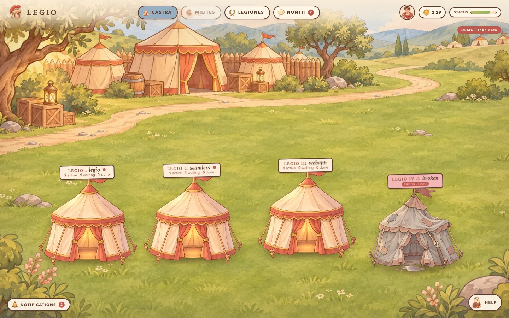
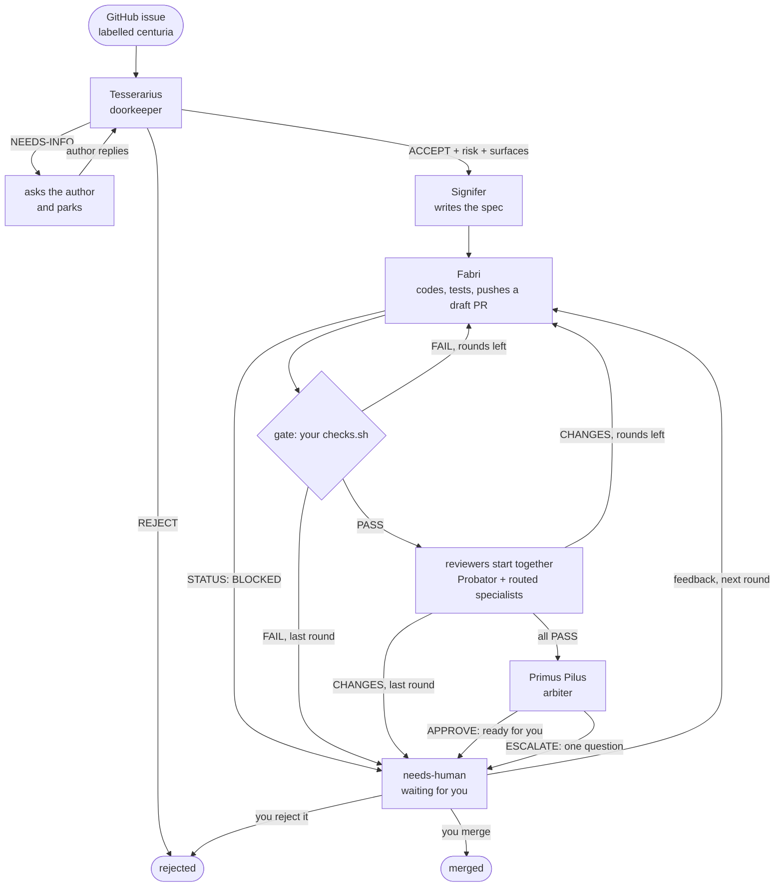
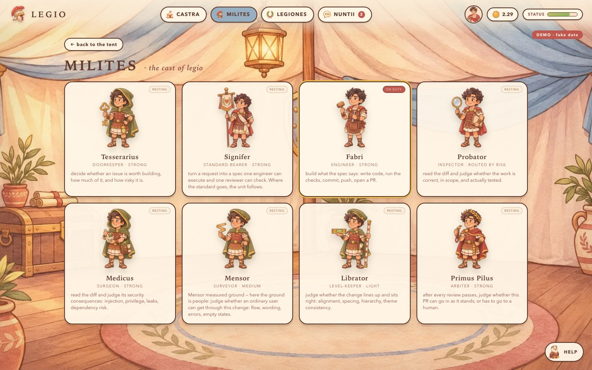
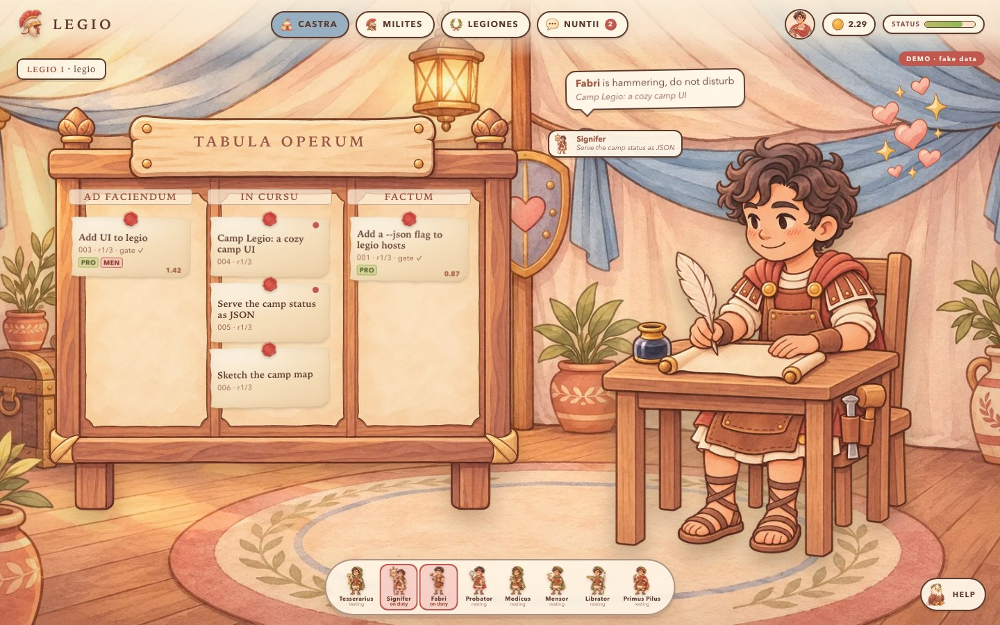
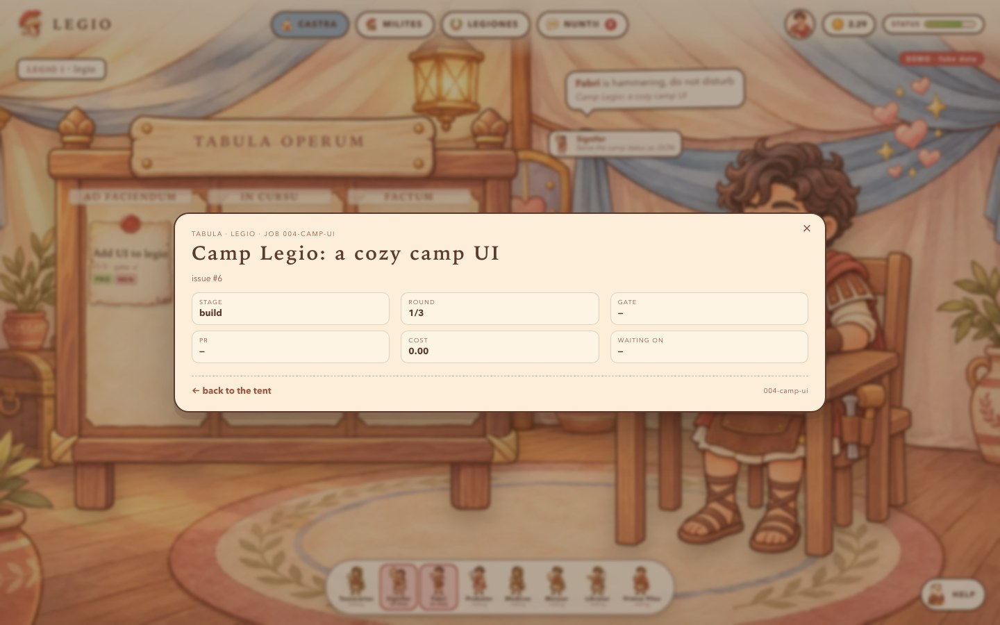
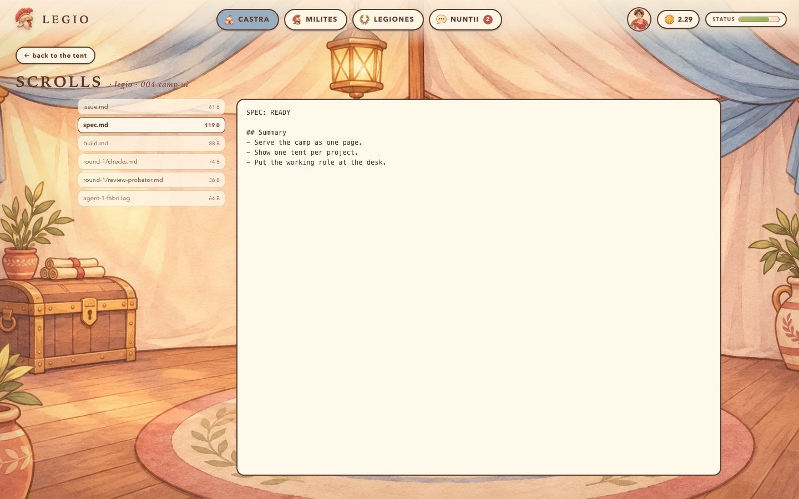
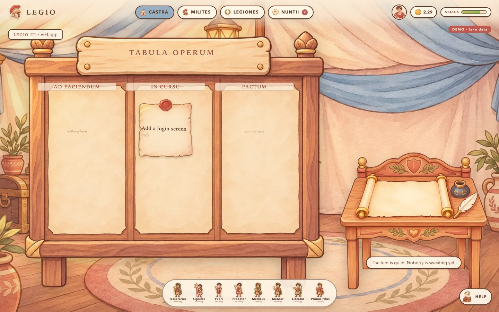
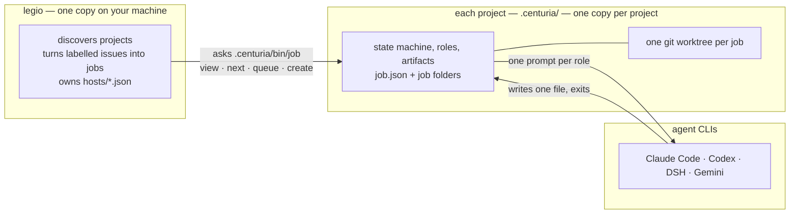

<p align="center">
  
</p>

<p align="center"><sub><i>Demo camp — the screenshots use fake projects.</i></sub></p>

<h1 align="center">legio</h1>

<p align="center">
  <b>Label a GitHub issue. A Roman legion picks it up.</b><br>
  Intake → spec → code → gate → review → ready PR, with a human on the merge button.
</p>

<p align="center">
  <a href="#quick-start">Quick start</a> ·
  <a href="#the-cast">The cast</a> ·
  <a href="#how-a-job-flows">How a job flows</a> ·
  <a href="#camp-legio--the-dashboard">Dashboard</a> ·
  <a href="#swarm--reviews-without-the-factory">swarm</a> ·
  <a href="#go-deeper">Docs</a>
</p>

---

## What is this?

**legio is a local software factory.** You label a GitHub issue; a fixed pipeline takes it
from there: a doorkeeper decides whether the issue is worth building, a spec-writer turns it
into something executable, a builder writes the code and opens a pull request, and a small
cast of reviewers checks the diff. When everything is green it hands the PR back to you —
**it does not merge for you by default.**

It is not a service, a framework, or a SaaS. It is a few standard-library Python scripts
plus a set of role prompts, running on your machine against the agent CLI you already
use.

Four pieces ship in this repository:

| piece | what it does | lives in |
|---|---|---|
| **legio** | the command: finds projects, turns labelled issues into jobs, owns the host registry | `legio`, `hosts/` |
| **centuria** | the pipeline: state machine, roles, artifacts, one git worktree per job | `centuria/` → `<project>/.centuria/` |
| **swarm** | review-only: hand it a diff, get reviewer verdicts back | `swarm/` |
| **web** | a read-only camp dashboard for watching it all | `web/` |

Two ideas make it feel different from a CI pipeline:

- **The pipeline is a template, not a framework.** legio has no idea which stages exist.
  It only knows how to ask a project for a work order and a view, and how to forward
  commands to it. The stages, roles and artifacts live in `<project>/.centuria/`.
  Upgrading the pipeline means copying a new `.centuria/` in — legio itself does not
  change. Delete legio and a stationed project still carries `bin/centuria`, so it can
  drive itself given a host spec (`--host-spec`).
- **An agent is a courier, not an assistant.** Work order in, one file out, exit. Nothing
  about a job lives in a conversation: it lives in `job.json` and the markdown artifacts.
  That is why a crashed session resumes cleanly, why you can swap Claude Code for Codex
  mid-project, and why a chatty model cannot corrupt the state.

## How a job flows



What the shape enforces:

- **The doorkeeper cuts before code is written.** An issue can be accepted with reduced
  scope, parked until it has the information it needs, or rejected.
- **Nothing reaches a reviewer on a red build.** The gate runs your own `checks.sh` inside
  the job's worktree, and fails if the branch edits a protected file.
- **Reviewers are independent, so they run at the same time.** Four reviewers cost one
  reviewer's wall-clock time, not four.
- **The arbiter does not decide alone.** It either says the PR is ready for you, or
  escalates the single question a human has to answer.

*(The diagram shows the default `human` policy. A parked issue can also be rejected outright,
and with `merge_policy: "legio"` an approved PR can go through `merging` via `centuria merge`.)*

## Quick start

**You'll need:** Python 3.10+ (standard library only), Git, an authenticated GitHub CLI
(`gh auth login`), and at least one agent CLI on your `PATH` — Claude Code, Codex, DSH,
or Gemini. The repo also ships `echo` and `fake` hosts so the pipeline can be exercised
without a model.

```bash
# 0. get it and put the command on your PATH
git clone https://github.com/weirui828/legio.git ~/dev/legio
ln -s ~/dev/legio/legio /usr/local/bin/legio   # or: export PATH="$HOME/dev/legio:$PATH"

# 1. tell legio where your projects live (default: ~/dev)
$EDITOR ~/dev/legio/config.json

# 2. station a centuria in a git repo with a GitHub remote
legio add ~/dev/webapp --host claude-code

# 3. make it honest: real checks, and this project's policy
$EDITOR ~/dev/webapp/.centuria/checks.sh       # exits 1 until you fill it in, on purpose
$EDITOR ~/dev/webapp/.centuria/config.json     # base_branch, protected_paths, merge_policy

# 4. create the three GitHub labels, then verify the installation
legio labels webapp
legio doctor webapp

# 5. open an issue, label it "centuria", and drive
legio run webapp --max-steps 20
```

`legio add` copies the pipeline into the project and excludes everything it writes in
`.git/info/exclude` — **not** `.gitignore`. No tracked file changes and `git status` stays
clean.

While it runs:

```bash
legio inbox                     # waiting jobs, with the reason
legio status --all              # every job, active or not
legio next webapp               # a pasteable prompt, if you'd rather drive the agent yourself
legio say webapp:001-... "make the flag default to on"   # send it back to build
legio reject webapp:001-... "out of scope for now"
```

When a PR is ready, open it on GitHub and merge it. The next `legio sync` notices the
merge and closes the job out.

Prefer to drive it yourself? `legio next` prints the exact prompt to paste into an agent,
and `.centuria/bin/centuria run` works without legio if you pass it a host spec.

## The cast

The names are Roman army posts, so **the name tells you nothing about the function** —
each role file opens with the line that does. A **surface** is the part of the change
that matters: `ui` means a person will see it, `security` means it touches privileges,
secrets or dependencies. Here is the whole cast:

| Roman name | Plain English | What it decides | Writes | When |
|---|---|---|---|---|
| **Tesserarius** | doorkeeper | Is this worth building, how much of it, how risky is it? | `intake.md` | once, at the door |
| **Signifer** | spec-writer | What exactly does "done" mean, and what is out of scope? | `spec.md` | after ACCEPT |
| **Fabri** | builder | Build it, run the checks, commit, push, open the PR. | `build.md` + code | every round |
| **Probator** | inspector | Is it correct, in scope, and actually tested? | `review-probator.md` | every round |
| **Medicus** | surgeon | Security: injection, privilege, leaks, dependencies. | `review-medicus.md` | `security` surface |
| **Mensor** | surveyor | Can an ordinary user get through it, and recover from errors? | `review-mensor.md` | `ui` surface |
| **Librator** | level-keeper | Alignment, spacing, hierarchy, theme. | `review-librator.md` | `ui` surface |
| **Primus Pilus** | arbiter | Can this go in, or does a human have to decide? | `decision.md` | after reviews pass |

The cast is fixed; the instances are not. A low-risk job that runs all three rounds and
finally passes spawns nine agent processes; add the UI and security reviewers and it is
eighteen. Each role is bound to a **tier** (`light` / `medium` / `strong`), which the host
file turns into a concrete model — so routing is a table lookup, not a prompt.

<p align="center">
  
</p>

<p align="center"><i>MILITES — the cast page in the dashboard. Two roles are on duty.</i></p>

## Camp Legio — the dashboard

You do not have to read terminal tables to see what is happening. `web/` turns every
stationed project into a tent in a Roman camp, with its jobs on the **TABULA OPERUM**
and the role that is working right now at the desk. It is read-only by construction: it
reads `centuria view` and the `live.json` heartbeat, and writes nothing to any project.

```bash
python3 web/serve.py            # http://127.0.0.1:8766
python3 web/serve.py --demo     # a fake camp you can click around, no projects needed
```

| | |
|:---:|:---:|
|  |  |
| **The tent.** One project's jobs in three lanes — waiting, in progress, finished — with the on-duty role at the desk. | **The job.** Stage, round, gate, PR, cost, and what is waiting on a human. |
|  |  |
| **The scrolls.** Read the issue, intake, spec, build, checks, reviews and agent logs in one pane. | **The quiet tent.** When nothing is running, the desk says so instead of faking it. |

The board knows nothing about stages: it turns `active` / `waiting` / `terminal` into
lanes. The desk knows who is working from a `live.json` heartbeat around each agent call,
so parallel reviewers and concurrent jobs both show up. Full reference, endpoints and the
art pipeline: [`web/README.md`](web/README.md).

<p align="center"><i>Screenshots are from <code>--demo</code> mode, so the data is fake — the layout is the real thing.</i></p>

## swarm — reviews without the factory

`swarm` is the review half of the system, extracted as a small standalone tool. No issue,
no spec, no build, no rounds, no merge — **you hand it a diff and it hands back verdicts.**

```bash
./swarm/swarm run code-reviewer on ~/dev/webapp    # one reviewer
./swarm/swarm run all on ~/dev/webapp              # all five, at the same time
```

A run lands in `<repo>/.swarm/<run-id>/`: the diff, one `review-<name>.md` per reviewer,
a combined `report.md` and `report.json`. The five reviewers are `code-reviewer`,
`security-reviewer`, `ux-reviewer`, `ui-reviewer` and `ios-reviewer`. Exit codes: `0` all
PASS · `1` any CHANGES · `2` operational error · `3` empty diff. It keeps no state between
runs and never comments, labels or merges. Full reference:
[`swarm/README.md`](swarm/README.md).

## Design promises

- **Your `git status` stays clean.** Everything legio creates in a project is excluded
  through `.git/info/exclude`, never `.gitignore`. No tracked file in your project changes.
- **One writer for job state.** Only `centuria/bin/job` writes `job.json`: it holds a file
  lock, writes atomically, and validates every transition. Anything that wants to change
  state goes through it.
- **It never merges for you by default.** `merge_policy` is `human`: an APPROVE only turns
  the PR ready and tells you. The merge button is yours.
- **No lock-in.** Roles are markdown, hosts are JSON, state is plain files. Copy a newer
  template over `.centuria/` by hand (merging `config.json` and `checks.sh`); delete legio
  and the project still has its state machine, given a host spec.

## Under the hood



The split is the whole design: **legio knows about projects and agent CLIs; a centuria
knows about stages and roles.** legio never reads `job.json` — it shells out to the
centuria's own CLI for a view, a work order or the queue, and forwards commands. The loop
itself (`job next` → agent → `job done`) belongs to the centuria's runner, so the two sides
never need to share a vocabulary.

<details>
<summary>Repository layout</summary>

```
legio/
├── legio                  the command (add, run, next, inbox, doctor, ...)
├── config.json            projects_root
├── hosts/                 one JSON per agent CLI (claude-code, codex, dsh, ...)
├── centuria/              the template copied into a project
│   ├── bin/               centuria, job (state machine), run (loop), gate (checks)
│   ├── roles/             the eight role prompts
│   ├── config.json        routing, protected paths, merge policy
│   └── checks.sh          the project's real checks (you fill this in)
├── swarm/                 review-only: diff in, review files out
├── web/                   the Camp Legio dashboard (stdlib server + assets)
├── docs/                  art direction and design notes
└── tests/                 host-registry and heartbeat tests, plus the fake-agent harness
```

</details>

## Go deeper

| document | what is inside |
|---|---|
| [`AGENTS.md`](AGENTS.md) | the complete technical reference: contracts, state machine, host profiles, recipes for adding a role, stage or host |
| [`swarm/README.md`](swarm/README.md) | the review-only tool: flags, exit codes, the Python library API |
| [`web/README.md`](web/README.md) | the dashboard: endpoints, read-only guarantees, asset pipeline |
| [`docs/ui/`](docs/ui/) | the art direction and the Camp Legio design brief |
| [`centuria/roles/`](centuria/roles/) | the eight role prompts themselves |

The repo tests itself offline — no model, no network:

```bash
python3 -m unittest discover -s swarm/tests -v
python3 -m unittest discover -s web/tests -v
```

---

<p align="center"><i>No hosted service, no account, no telemetry. Python standard library and the agent CLI you already pay for.</i></p>
